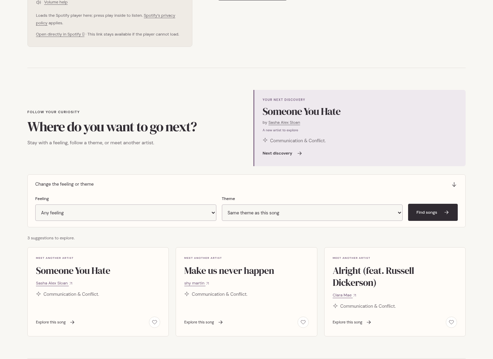
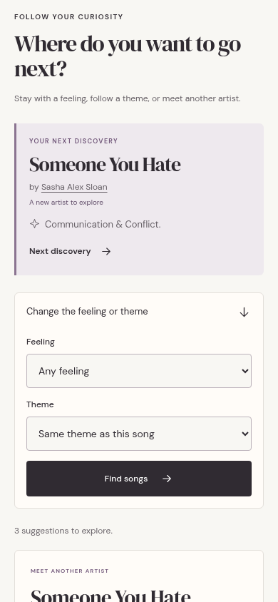

# Shared tags — Core 0.15.0 / Theme 0.9.0

[Download combined update](https://github.com/richardlhvn/HvN-Space/raw/refs/heads/tunetofond-tag-sync-2026-11-14/downloads/tunetofond_tag_sync_Core_0.15.0_Theme_0.9.0.zip) · [Local instructions](../downloads/README_TAG_SYNC_UPDATE.md)

The owner authorized changing all current classification tags on 14 November 2026, including stored research and active bundled data. This supersedes the earlier presentation-only genre/mood policy. The Google Sheet and XLSX are unchanged and await the owner’s later synchronization.

## Shared vocabulary

### 15 genre groups

| Shared label | Previous labels / aliases |
| --- | --- |
| Pop | pop, emotional-pop, confessional-pop, duet-pop, pop-duet, romantic-pop, norwegian-pop, swedish-pop |
| Indie Pop | indie-pop |
| Alternative Pop | alternative-pop, alt-pop |
| Electronic | electronic, electronic-pop, electropop, emotional-electronic-pop, electronic-emotional-pop, synth-pop |
| Dance Pop | dance-pop |
| Acoustic Pop | acoustic-pop, acoustic-influenced-pop, stripped-back-pop |
| Folk Pop | folk-pop |
| Indie Folk | indie-folk |
| Singer-Songwriter | singer-songwriter, singer-songwriter-pop, alternative-singer-songwriter-pop, confessional-singer-songwriter-pop, folk-influenced-singer-songwriter-pop |
| Country Pop | country-pop, country-influenced-pop, country-pop-influence, country-tinged-pop |
| R&B / Soul | alternative-rb, rb-influence, soul-influenced-pop, soul-influenced-singer-songwriter-pop |
| Piano Pop | piano-pop |
| Ballads | ballad, pop-ballad, pop-ballads |
| Chill Pop | chill-pop |
| Bedroom Pop | bedroom-pop |

### 20 mood groups

| Shared label | Previous labels / aliases |
| --- | --- |
| Heartbreak | heartbreak, heartbroken, hurt |
| Reflection | reflective, introspective, self-aware, confessional, candid, regretful |
| Playful | playful, cheeky, wry, carefree |
| Hopeful | hopeful, uplifting |
| Nostalgia | nostalgic, wistful |
| Love & Affection | romantic, affectionate, tender, warm, appreciative |
| Longing | longing, romantic-longing, yearning |
| Melancholy | sad, melancholic, somber, sorrowful, grieving, lonely, excluded |
| Vulnerability | vulnerable, raw, intimate, heartfelt |
| Comfort | comforting, reassuring, compassionate, empathetic |
| Confidence | confident, assertive, bold, defiant |
| Anxiety | anxious, uneasy, unsettled, restless, self-conscious, cautious |
| Mixed Feelings | conflicted, uncertain, hesitant |
| Resilience | resilient, resolute, determined |
| Letting Go | accepting, resigned, cathartic |
| Calm | calm, restrained |
| Dreamy | dreamy |
| Energetic | energetic, upbeat, euphoric, summer-energy |
| Intense | intense, dramatic |
| Bittersweet | bittersweet |

### 20 theme groups

| Shared label | Previous labels / aliases |
| --- | --- |
| Love & Romance | love, early-romance, first-meeting, infatuation, romantic-attraction, romantic-confidence, short-lived-romance, unexpected-encounter, unexpected-encounters, unspoken-romantic-attraction, unspoken-romantic-attraction-press-release-characterization |
| Relationships | relationships, relationships-and-personal-reflection, being-a-second-choice, conflicted-attraction, dating, dating-ambiguity, doubt, emotional-detachment, emotional-disconnection, falling-out-of-love, jealousy, manipulation-in-a-relationship, new-relationships, one-sided-relationships, painful-attraction, past-relationships, push-pull-relationships, relationship-comparison, relationship-deterioration, relationship-timing, repeated-relationship-mistakes, timing, uncertainty, unequal-commitment, unhealthy-attachment, unreciprocated-affection |
| Heartbreak & Breakups | breakup, breakups, heartbreak, separation |
| Longing & Distance | distance, emotional-distance, lingering-attachment, lingering-feelings, lingering-love, missed-connection |
| Memories & Nostalgia | breakup-memories, idealizing-the-past, lost-familiarity, memory, nostalgia, photos, post-breakup-memories, preserving-memories |
| Moving On & Closure | acceptance, closure, letting-go, moving-on, starting-over, uncertain-closure |
| Trust & Commitment | choosing-love-despite-uncertainty, commitment, emotional-certainty, emotional-clarity, mutual-respect, secure-commitment, trust-in-love, unconditional-love |
| Communication & Conflict | arguments, avoidance, communication, different-viewpoints, frustration, guilt, regret, self-blame |
| Friendship | companionship, friendship, friendship-changes, lost-friendship, old-friends, post-breakup-friendship, summer-reunions, unequal-friendship |
| Family & Childhood | childhood, childhood-home, family, family-changes |
| Growing Up & Change | adolescence, change, growing-up, growth, lost-innocence, personal-growth, resistance-to-change |
| Identity & Belonging | belonging, feeling-overlooked, gender-stereotypes, identity-in-relationships, isolation, social-displacement, social-exclusion |
| Self-Worth & Body Image | body-image, feeling-insufficient, imperfection, insecurity, self-acceptance, self-acceptance-struggles, self-comparison, self-criticism, self-doubt, self-image, self-worth |
| Mental Health & Anxiety | anxiety, concealed-emotional-pain, depression, emotional-distress, emotional-numbness, emotional-overwhelm, existential-unease, helplessness, mental-health, mental-wellness, overwhelm, overwhelming-moments, panic, relationship-anxiety, searching-for-relief |
| Grief & Loss | bereavement, grief, loss, loss-of-a-partner, remembering-a-friend, renewed-grief |
| Healing & Recovery | love-after-heartbreak, past-relationship-wounds, personal-recovery, processing-hurt, recovery, writing-to-heal |
| Support & Kindness | emotional-reassurance, emotional-support, empathy, encouragement, goodwill, mutual-support, support, support-through-hardship, wishing-someone-well |
| Independence & Self-Belief | independence, self-belief |
| Vulnerability | emotional-risk, fear-of-vulnerability, risking-love-again, vulnerability |
| Life & Purpose | escapism, happiness, living-in-the-moment, meaning, pandemic-experience, purpose, reflection, shared-routines, world-events |

## Stored data and provenance

- All existing artist/song records, including drafts, trash and retained hidden records, are considered by the tag-only migration. Country assignments are untouched. Empty tags stay empty.
- Consolidate known genre and mood assignments onto canonical term slugs/names; deduplicate comma-separated theme names. Retire atmospheric, melodic and late-night from moods without inventing an emotion.
- Normalize only `genres`, `moods`, and `themes` inside `_ag_handoff_record`. Normalize only equivalent portions of `_ag_handoff_baseline` and `_ag_reviewed_baseline`, preserving unrelated edit conflicts. Refresh reviewed payload hashes only when their pre-migration inputs still match the stored hash.
- Normalize all 53 active individual research bundles. The active ten/128 snapshot is `reviewed-tunetofond-tags-2026-11-14.json`. Its only record differences from the branded snapshot are classification arrays. An explicit `tag_adjustment` records the owner authorization and pending workbook sync.
- Original reviewed snapshots and original workbook checksum remain unchanged. The checksum identifies the original workbook, not an updated export. `tag-sync-original-tags-2026-11-14.json` archives 491 changed original tag sets from the source baseline at commit `42324ecfa865a57ad7ca7748e2d5c58ef0188080`.
- Historical unused taxonomy terms remain as compatibility aliases; current assignments use canonical terms. Legacy directory and native taxonomy URLs resolve to populated public groups. The public theme menu only lists populated shared themes.

## Migration protection

Administrator capability, the shared research-import lock and a database transaction protect application. Dry run never writes the record or term tables. Unknown labels, duplicate protected metadata or non-default navigation overrides block the whole batch. An injected write failure verifies rollback of term creation, assignments and metadata. The operation never rewrites post fields, sources, rights, media, Spotify links, IDs/slugs, publication dates/statuses or public scope. A repeat application has no remaining record/term changes.

## Staging validation

- Private backup made before application. 613 existing artist/song records inspected: 384 updated, 229 already normalized; zero conflicts. Repeat: zero updates and zero term changes.
- Preservation fingerprints match across every post and protected metadata field, non-genre/mood relations and site/public-scope options after accounting for exactly the authorized tag transformation. The ten/128 public selection and all 475 excluded records retain their visibility.
- 811 read-only canonical reconciliation checks pass, including exact approved wording, original workbook provenance, owner-approved recording URLs and public scope.
- 294 isolated migration checks cover authorization, dry run, unknown/override protection, full rollback, later editor conflicts, hidden/trash handling, canonical stored records and repeatability.
- 305 theme browser checks cover exactly 20 topics, stored names, all topic result memberships, historical URLs, desktop/mobile, no-JavaScript forms and preservation of the existing player iframe. This is a player-lifecycle check, not audio verification.
- Source comparison verifies that all 53 active bundles and the active canonical record sets change only classification arrays.

